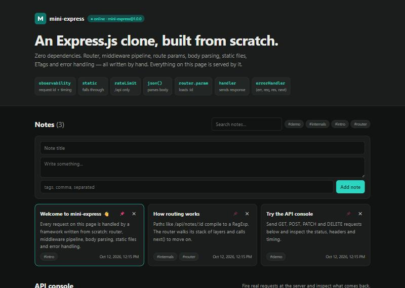
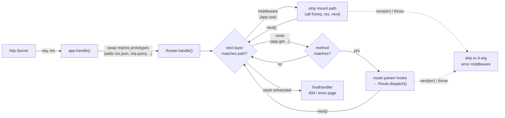

# mini-express

> A zero-dependency re-implementation of [Express.js](https://expressjs.com), built from scratch to understand how a Node.js web framework actually works.


```js
const express = require('mini-express');
const app = express();

app.use(express.json());

app.get('/users/:id', async (req, res) => {
  const user = await db.find(req.params.id);   // thrown errors & rejections are caught
  res.status(200).json(user);
});

app.listen(3000);
```

The API mirrors Express, so if you know Express you already know mini-express. The difference is that every line is here to read: **~1,400 lines of commented code, 0 npm dependencies, 82 tests.**

---

## Highlights

| Area | What's implemented |
| --- | --- |
| **Routing** | `app.get/post/put/patch/delete/all(...)`, `app.route()` chaining, route params (`/:id`, optional `/:id?`, `/:from-:to`), wildcards (`/files/*`), RegExp routes, case-sensitive & strict modes |
| **Middleware** | `app.use()` with path prefixes, segment-aware mount matching, `next()`, `next('route')`, `next('router')`, nested `Router`s, `mergeParams`, mounted sub-apps with inherited settings |
| **Async** | Handlers can be `async`; rejected promises go to the error handler automatically (Express 5 behavior) |
| **Errors** | 4-argument error middleware, error recovery, a default handler that hides stack traces in production |
| **Request** | `req.params`, `req.query`, `req.path`, `req.get()`, `req.is()`, `req.accepts()` with q-values, `req.ip` / `req.protocol` / `req.hostname` with `trust proxy` |
| **Response** | `res.status()`, `send()`, `json()`, `sendStatus()`, `redirect()`, `set()`, `append()`, `type()`, `cookie()`, `clearCookie()`, `sendFile()`, `download()`, `locals` |
| **Caching** | Automatic weak ETags on `res.send()`, `304 Not Modified` for fresh `If-None-Match` / `If-Modified-Since` requests |
| **Built-ins** | `express.json()`, `express.urlencoded()` (with size limits → 413), `express.static()` (index files, directory redirects, path-traversal & dotfile protection) |
| **HTTP details** | `HEAD` falls back to `GET` without a body, automatic `OPTIONS` with an `Allow` header, `router.param()` hooks |

## Demo app

`examples/notes-app` is a small production-style app built **only** on mini-express:

- A REST API for notes (`GET/POST /api/notes`, `GET/PATCH/DELETE /api/notes/:id`, search and tag filters)
- Custom middleware: request IDs and timing headers, colored access logs, a rate limiter with `RateLimit-*` headers
- Validation errors (422), JSON parse errors (400), async errors (500) and JSON 404s, all through one error handler
- A dashboard UI served by `express.static()`, with a **live API console** for firing requests and inspecting status, headers and timing

```bash
npm start            # http://localhost:3000
npm run dev          # same, restarting on file changes
```



### API

| Method | Path | Description |
| --- | --- | --- |
| `GET` | `/api/health` | Status, version, uptime |
| `GET` | `/api/notes?q=&tag=` | List notes (pinned first), with optional search and tag filter |
| `POST` | `/api/notes` | Create `{ title, body?, tags?, pinned? }` → `201` + `Location` |
| `GET` | `/api/notes/stats` | Totals and tag counts |
| `GET` | `/api/notes/:id` | Fetch one note (`404` if missing) |
| `PATCH` | `/api/notes/:id` | Partial update |
| `DELETE` | `/api/notes/:id` | Delete → `204` |
| `ANY` | `/api/echo/*` | Echoes the parsed request (params, query, body, headers) |
| `GET` | `/api/boom` | Throws inside an async handler, to show error handling |

```bash
curl -X POST localhost:3000/api/notes \
  -H 'content-type: application/json' \
  -d '{"title":"From curl","tags":["cli"]}'
```

## How it works

The core idea of Express is small: **an app is a function `(req, res)` that walks a stack of layers.**



| File | Role |
| --- | --- |
| [`lib/express.js`](lib/express.js) | `createApplication()`. The app is a plain function, so it can be passed to `http.createServer()`. |
| [`lib/application.js`](lib/application.js) | `app.use/get/route/param/set/listen`, sub-app mounting, settings inheritance |
| [`lib/router/index.js`](lib/router/index.js) | **The heart of the framework:** the `next()` loop, prefix stripping, `req.baseUrl`, error routing, param hooks |
| [`lib/router/route.js`](lib/router/route.js) | One path with a per-method handler stack |
| [`lib/router/layer.js`](lib/router/layer.js) | Path matcher and handler; turns throws and rejected promises into `next(err)` |
| [`lib/utils/path-to-regexp.js`](lib/utils/path-to-regexp.js) | Compiles `/users/:id?` into a RegExp |
| [`lib/request.js`](lib/request.js), [`lib/response.js`](lib/response.js) | Prototypes inheriting from `http.IncomingMessage` / `http.ServerResponse` |
| [`lib/middleware/`](lib/middleware) | `json`, `urlencoded`, `static` |
| [`lib/finalhandler.js`](lib/finalhandler.js) | Last-resort 404 and error responses |

### Interesting details

- **Prototype swapping.** Express doesn't wrap `req`/`res`. It calls `Object.setPrototypeOf(req, app.request)`, so the native objects gain methods with no copying. Each app gets its own prototype, which is how `req.app` works inside mounted sub-apps.
- **Arity is the API.** A function with 4 parameters is an error handler. The router checks `fn.length` to decide whether to call `fn(req, res, next)` or `fn(err, req, res, next)`.
- **Mount paths are temporary.** For `app.use('/api', router)`, the router slices `/api` off `req.url` before calling the middleware and puts it back when `next()` is called. That's why `req.url` is relative inside a router while `req.originalUrl` never changes.
- **Segment-aware prefixes.** `app.use('/api')` matches `/api/users` but not `/apiary`, via a `(?=/|$)` lookahead.
- **Security.** `express.static` resolves every path inside its root and rejects `..` escapes (including encoded `%2e%2e`) and dotfiles. Error pages HTML-escape the URL, and production mode hides stack traces.

## Project origin

This started as a tutorial-style skeleton with five files (`express.js`, `app.js`, `router.js`, `route.js`, `layer.js`). An audit of that skeleton found:

1. **No path matching.** The router dispatched every request to the first registered route.
2. **Layers discarded their path**, so params were impossible.
3. **Regular handlers were treated as error handlers.** The check was `fn.length > 2`, and `(req, res, next)` has length 3.
4. **Routes ignored the HTTP method** when dispatching.
5. No `app.use`, `listen`, params, query parsing, body parsing, `req`/`res` helpers or error middleware.

mini-express rewrites the skeleton into a full implementation with tests for each of those cases.

## Development

```bash
npm test                 # 82 tests via node:test, no test framework needed
npm run test:coverage    # ~95% line coverage of lib/
node examples/hello-world.js
docker build -t mini-express . && docker run -p 3000:3000 mini-express
```

Requires Node.js 22+. There is nothing to `npm install`.

## Not implemented (yet)

View rendering (`res.render`), `res.format()`, signed cookies and cookie parsing, Range requests and HTTP/2 specifics. mini-express is a learning project; use [Express](https://expressjs.com) in production.

## License

[MIT](LICENSE)
